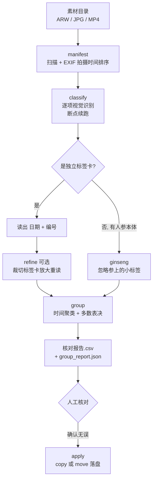

# ginseng-sort · 人参素材按手写标签自动归类

**把「标签卡 + 人参本体」的照片（含 Sony RAW）和视频，按手写标签上的日期+编号自动分到 `日期_编号` 文件夹。**

全流程**本地离线**（Ollama + 视觉模型），**零云 token、不经任何在线 AI** —— 唯一的网络请求是 `127.0.0.1:11434`。

---

## 一、为什么需要它

收购来的每一根人参都要拍照建档：一根一支 **手写标签卡**（第一行日期、第二行编号）+ 若干张人参本体照片/视频。
几百上千个文件混在一个目录里，靠人工按标签分文件夹：

- 慢，且长时间看手写数字容易串行（7 看成 1、5 看成 15）
- 同一根的多个镜头要归到一起
- **中间有没拍到的编号**时，人工很难发现

本项目把这件事做成了流水线。实测跑完 **2799 个文件，分成 30 个 `日期_编号` 文件夹**。

---

## 二、流水线



| 阶段 | 做什么 |
|---|---|
| `manifest` | 扫描所有媒体，**按 EXIF 拍摄时间排序**（比手写日期可靠，且两者通常一致） |
| `classify` | 逐项送本地视觉模型识别，结果缓存到 `results.json`，**中断可续跑** |
| `refine` | 对判定为「标签」的项，裁切卡片放大后重读编号；`--cv2` 改用红边轮廓裁切 |
| `group` | 标签事件**时间聚类** + **多数表决**取编号，生成核对报告（干跑，不动文件） |
| `apply` | 按报告落盘，`--mode copy` 保留原文件 / `--mode move` 删源 |

---

## 三、几个不显然的设计

### 1. 「标签」和「人参」怎么区分

人参上部系绳处**也有一个小标签**（写着字），容易被误判成标签卡。规则定为：

> 画面里**有人参本体** → 一律判 `ginseng`（**忽略**参上的小标签，即使有字）；
> 只有**单独的手写标签卡**才是 `label`。

### 2. 时间聚类 + 多数表决，消掉孤例误读

同一根人参的照片和视频是在几十秒内连续拍的，而相邻两根之间隔几分钟。
于是用 `cluster_gap_sec`（默认 60s）把标签事件聚成组，**取组内出现次数最多的编号**：

```
一根参的 5 个镜头读出: [7, 7, 1, 7, 7]  →  取 7   （把 7 读成 1 的那次被投掉）
```

### 3. 跳号 → 单独隔离，不猜

如果相邻两组编号出现大间隔（如 6→8），说明中间还有**没拍到 / 没读出的标签根**，
这批混料单独放进 `跳号待定_日期_6到8`，**交人工分发，绝不悄悄并进错误的根**。

### 4. RAW 只取内置预览

Sony `.ARW` 用 `rawpy.extract_thumb()` 抽**内置全分辨率 JPEG 预览**来识别 ——
不需要完整解 RAW、不需要额外插件、速度快一个数量级。

> 坑：非 RAW 文件不能走 `rawpy.imread`（会抛 "not RAW file"），代码里按扩展名分流。

### 5. 零云 token

我 grep 过全部网络调用，**只有 `127.0.0.1:11434`**（本机 Ollama）。
素材不上传、不消耗任何在线额度，同事可以直接跑。

---

## 四、快速开始

```bash
# 1) 一键装环境（建 venv、装 rawpy/pillow/numpy、检查 ffmpeg 与 ollama、拉模型、生成 config.json）
bash scripts/setup.sh

# 2) 编辑 config.json，把目录改成你的素材位置
#    见下方「config 关键字段」

# 3) 一键全流程（默认 copy，不动原文件）
bash scripts/run.sh
```

分步跑（方便插入人工核对）：

```bash
. .venv-ginseng/bin/activate
python scripts/pipeline.py check                        # 预检（缺库 / ffmpeg / ollama）
python scripts/pipeline.py manifest --config config.json # ① 扫描 + 按时间排
python scripts/pipeline.py classify --config config.json # ② 本地识别（断点续跑）
python scripts/pipeline.py refine   --config config.json # ③ 可选：标签卡裁切放大重读
python scripts/pipeline.py group    --config config.json # ④ 归组 + 核对报告（干跑）
python scripts/pipeline.py apply --config config.json --mode copy   # ⑤ 落盘（留原文件）
```

### Windows

同一份 `pipeline.py` 跨平台通用，另附 PowerShell 脚本：

```powershell
powershell -ExecutionPolicy Bypass -File scripts\setup_windows.ps1
scripts\run.bat
```

---

## 五、config.json 关键字段

| 字段 | 含义 |
|---|---|
| `photo_dirs` | 照片目录列表（可多个）。`*.arw` 走 rawpy 抽预览，`*.jpg/png` 直接读 |
| `video_dir` | 视频目录（`*.mp4/mov/mts`，用 ffmpeg 抽帧） |
| `out_root` | 归档根目录（生成 `<out_root>/日期_编号/`） |
| `cache_dir` | 缓存目录（`manifest/results/核对报告/进度`，可断点续跑） |
| `model` | Ollama 识别模型（默认 `qwen3.6:35b`，需带 vision） |
| `cluster_gap_sec` | 同一根多个标签事件聚类的最大间隔（秒），默认 60 |
| `move` | `apply` 缺省动作：`false`=copy、`true`=move 删源 |
| `use_cv2` | `refine` 用 OpenCV 红边轮廓裁切（备选，默认用白色掩码） |

---

## 六、输出物

| 文件 | 用途 |
|---|---|
| `<cache_dir>/核对报告.csv` | 逐项清单（文件 → 文件夹 → 读出的日期/编号 + 跳号/异常）。**人工核对的主要依据** |
| `<cache_dir>/group_report.json` | 机器可读的 文件→文件夹 映射、标签簇、跳号记录 |
| `<out_root>/日期_编号/` | 分类好的文件（`apply` 后生成） |

---

## 七、限界与提醒

- **手写标签无法保证 100%**。务必**先看 `核对报告.csv` 再 `apply`**，重点核对「跳号」和「标签未读出」的行。
- `apply --mode copy` 是默认值；`--mode move` **会删源文件**。
- 硬件门槛：35B 级视觉模型大约要 20GB+ 显存。显存不够会退 CPU，速度降到每张几十秒；
  换一个小一档的视觉模型即可（只改 `config.json` 的 `model`，提示词不用动）。
- **OpenCV 只是备选**：`--cv2` 用红边轮廓裁切标签卡，只对干净正拍的红边卡更稳；
  对潦草/缺失的手写帮助有限（实测对「581 误读」「9 读成 19」无效）。
  它**不能提速**，也不会替代大模型读号。
- 素材编号格式不同（不含日期、位数变化）时，只需改 `PROMPT` / `READ_CROP_PROMPT`
  和 `group` 里取编号的规则，其余不动。

---

## 八、项目结构

```
scripts/pipeline.py          主工具（全部阶段：manifest/classify/refine/group/apply/progress/check）
scripts/setup.sh             macOS/Linux 一键初始化
scripts/run.sh               macOS/Linux 一键运行
scripts/setup_windows.ps1    Windows 一键初始化
scripts/run.bat              Windows 一键运行
config.example.json          配置模板（复制成 config.json 再改）
requirements.txt             rawpy / pillow / numpy / opencv-python-headless
```

---

## License

MIT
